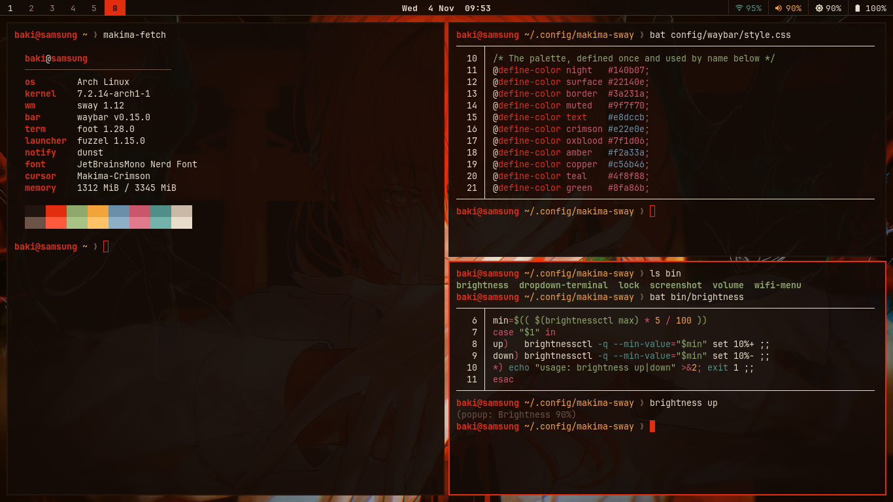
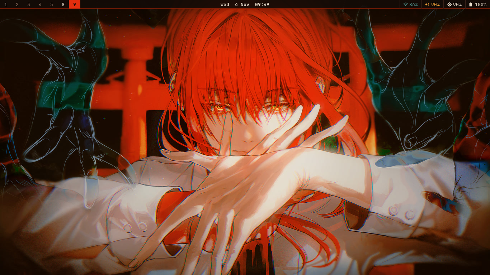
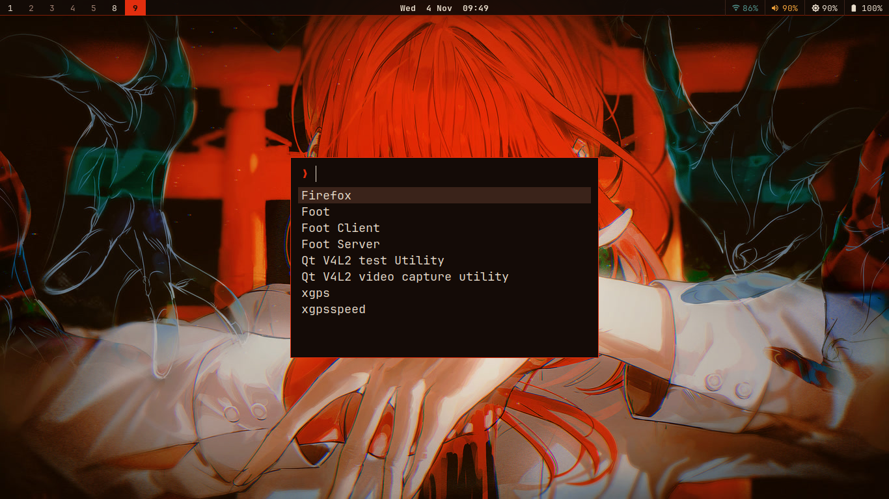
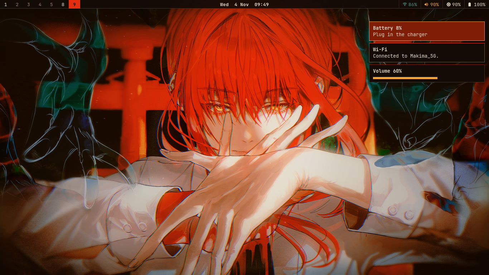
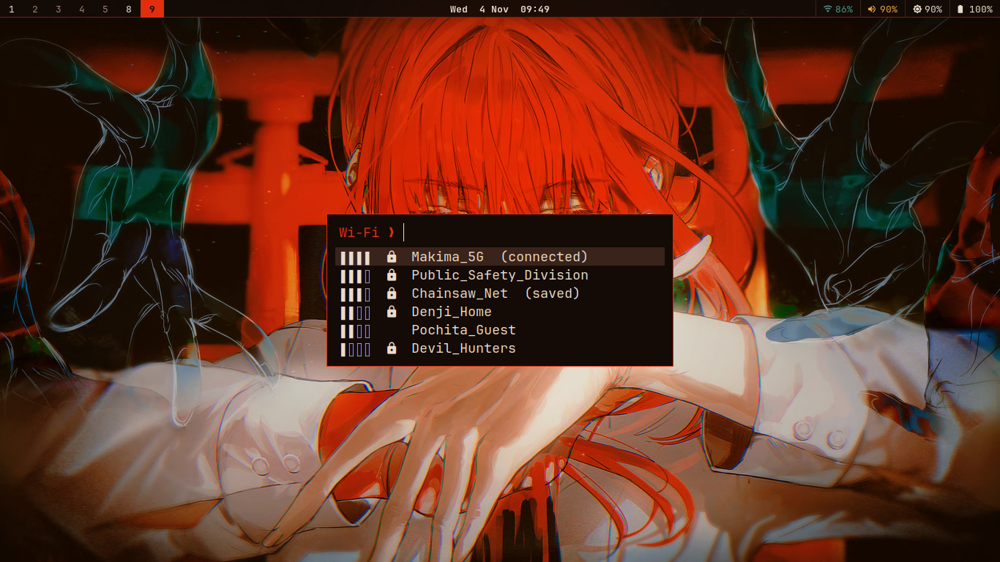
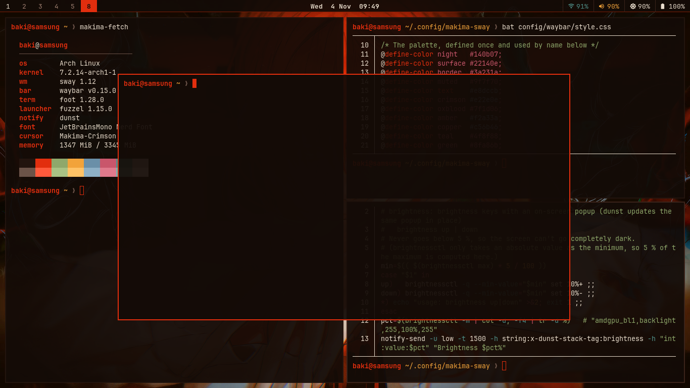
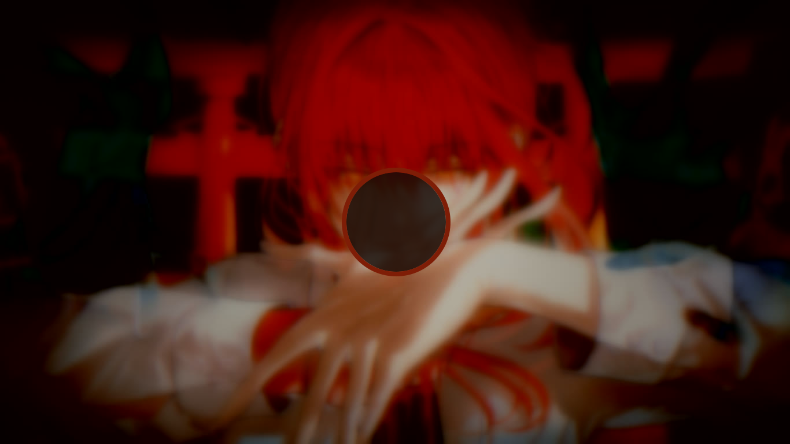
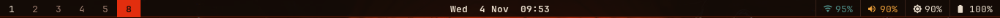
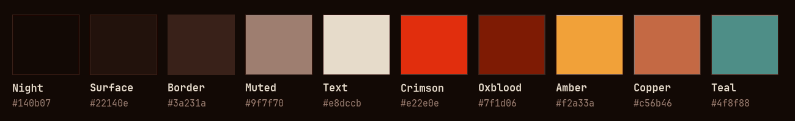

<div align="center">

# makima-sway

**A lightweight, hand-written Sway desktop themed after Makima from *Chainsaw Man*.**

Crimson hair, amber eyes, a dark shrine at night. Every color on screen is sampled from one wallpaper.




</div>

---

## Contents

- [About](#about)
- [Gallery](#gallery)
- [Features](#features)
- [Components](#components)
- [Color palette](#color-palette)
- [Requirements](#requirements)
- [Installation](#installation)
- [Starting Sway](#starting-sway)
- [Keybindings](#keybindings)
- [Scripts](#scripts)
- [Customization](#customization)
- [Troubleshooting](#troubleshooting)
- [Repository layout](#repository-layout)
- [Credits](#credits)
- [License](#license)

---

## About

This is my personal Sway setup. I didn't copy someone else's dotfiles. I wrote every file from scratch, using a few riced setups only as visual inspiration.

It was built for a weak laptop:

| | |
|---|---|
| Machine | Samsung 905S3G |
| CPU | AMD quad-core Temash APU, up to 1.4 GHz |
| GPU | Radeon HD 8250 (GCN 2, `amdgpu`, with `amdgpu.dc=0`) |
| RAM | 3.3 GB |
| Screen | 1366×768 |

That shaped the design rules:

- **No blur, no shadows, no animations.** Plain Sway, not SwayFX or Hyprland.
- **Transparency only in the terminal.** Everything else is opaque.
- **Fast, GTK-free tools where possible.** foot, fuzzel, and dunst all start instantly.
- **Expensive work happens once, ahead of time.** The lock screen blur is baked into an image with ffmpeg, and the wallpaper is pre-scaled to the screen size (~4 MB in memory instead of ~33 MB).

---

## Gallery

<table>
<tr>
<td width="50%"><b>Clean desktop</b><br></td>
<td width="50%"><b>App launcher (fuzzel)</b><br></td>
</tr>
<tr>
<td><b>Notifications by urgency (dunst)</b><br></td>
<td><b>Wi-Fi menu (iwd + fuzzel)</b><br></td>
</tr>
<tr>
<td><b>Dropdown terminal (<code>Super+U</code>)</b><br></td>
<td><b>Lock screen (swaylock)</b><br></td>
</tr>
</table>

**The bar:** one thin 24 px strip. Workspaces on the left, the date in the center, Wi-Fi, volume, brightness, and battery on the right.



**The cursor:** [Bibata Modern](https://github.com/ful1e5/Bibata_Cursor), recolored to the palette's crimson by a small script in this repo.


---

## Features

- **One palette everywhere.** Ten colors sampled from the wallpaper drive Sway, Waybar, foot, fuzzel, dunst, swaylock, the shell prompt, and even the mouse cursor.
- **Thin top bar.** A 24 px Waybar strip. The clock shows a month calendar on hover. Click the Wi-Fi icon for the network menu, scroll on volume or brightness to change them, click volume to mute.
- **Gaps and thin borders.** No title bars. The focused window gets a crimson 2 px border, and the wallpaper shows through the gaps.
- **Semi-transparent terminal.** foot at 93 % opacity with a crimson block cursor and a matching bash prompt.
- **Wi-Fi menu.** A small Python script asks `iwd` over D-Bus for networks, shows them in fuzzel with signal bars, and asks for a password when needed. Pick the connected network to disconnect, or a saved one to forget it (that is also how you enter a new password after it changed).
- **Notifications by urgency.** Volume and brightness popups get an amber progress bar. Critical alerts get an oxblood background and stay until you dismiss them.
- **Low battery warning.** A popup at 15 % and a critical one that stays at 7 %, once per level instead of every few minutes, and it gets through Do Not Disturb. Checked every 2 minutes by a systemd user timer; does nothing on a machine without a battery.
- **Lock screen.** A blurred, darkened copy of the wallpaper with a palette-colored ring. It locks after 10 min idle and before suspend, and the screen turns off at 11 min.
- **Screenshots.** Full screen or a selected region, saved to `~/Pictures/Screenshots/` (your XDG pictures folder, if you have one) and copied to the clipboard. Two shots in the same second never overwrite each other.
- **Dropdown terminal.** A floating scratchpad terminal toggled with one key.
- **Dark GTK apps (Sway only).** Firefox and other GTK apps go dark through `GTK_THEME`, without touching other desktops on the same account.
- **Coexists with i3.** Shared scripts branch on `$WAYLAND_DISPLAY`, and the Sway notification config is fully separate. I run i3 on tty1 and this setup on tty2.

---

## Components

| Role | Program | Config in this repo |
|---|---|---|
| Compositor | [sway](https://swaywm.org) | `config/sway/config` |
| Bar | [Waybar](https://github.com/Alexays/Waybar) | `config/waybar/config.jsonc`, `style.css` |
| Terminal | [foot](https://codeberg.org/dnkl/foot) | `config/foot/foot.ini` |
| Launcher | [fuzzel](https://codeberg.org/dnkl/fuzzel) | `config/fuzzel/fuzzel.ini` |
| Notifications | [dunst](https://dunst-project.org) | `config/dunst/dunstrc` |
| Lock screen | [swaylock](https://github.com/swaywm/swaylock) + swayidle | `config/swaylock/config`, `bin/lock` |
| Wallpaper | swaybg (through Sway) | `wallpapers/makima-torii.jpg` |
| Screenshots | grim + slurp + wl-clipboard | `bin/screenshot` |
| Wi-Fi | iwd (D-Bus) | `bin/wifi-menu` |
| Shell prompt | bash | `config/bash/makima-prompt.sh` |
| Cursor | Bibata Modern Amber → recolored | `design/recolor-cursor.py` |
| Font | JetBrainsMono Nerd Font | – |

---

## Color palette



I sampled these colors from the wallpaper with ffmpeg's `palettegen`, then adjusted them by hand for contrast. The config names are the variable names used in the config files.

| | Name | Hex | Config name | Taken from | Used for |
|---|---|---|---|---|---|
|  | Night | `#140b07` | `night` | dark corners | backgrounds: bar, terminal, menus, notifications |
|  | Surface | `#22140e` | `surface` | – | inactive elements, tooltips |
|  | Border | `#3a231a` | `border` | – | separators, selection background |
|  | Muted | `#9f7f70` | `muted` | shaded skin | empty workspaces, secondary text |
|  | Text | `#e8dccb` | `text` | white shirt | main text |
|  | **Crimson** | `#e22e0e` | `crimson` | hair, torii gate | **main accent**: focused window, active workspace, cursors |
|  | Oxblood | `#7f1d06` | `oxblood` | hair shadows | bar underline, low-urgency border, critical background |
|  | Amber | `#f2a33a` | `amber` | eyes | second accent: volume, progress bars, critical border |
|  | Copper | `#c56b46` | `copper` | lit skin | resize mode, low battery |
|  | Teal | `#4f8f88` | `teal` | ghostly hands | cool contrast: Wi-Fi |

<details>
<summary><b>Terminal (foot) 16-color palette</b></summary>

| | Normal | Bright |
|---|---|---|
| black | `#22140e` | `#6b5348` |
| red | `#e22e0e` | `#ff5a3c` |
| green | `#8fa86b` | `#a9c285` |
| yellow | `#f2a33a` | `#ffc266` |
| blue | `#6a8fa8` | `#8eb0c6` |
| magenta | `#c9566b` | `#e07a8c` |
| cyan | `#4f8f88` | `#74b3ab` |
| white | `#c9b8a6` | `#e8dccb` |

Background `#140b07` at alpha 0.93, foreground `#e8dccb`, cursor a crimson block (`#e22e0e`), selection `#3a231a`.

</details>

---

## Requirements

Tested on **Arch Linux** with sway 1.12, Waybar 0.15, foot 1.28, fuzzel 1.15, and dunst 1.13. Other distributions should work if the package names are adjusted.

### Packages

```bash
sudo pacman -S --needed \
	sway swaybg swayidle swaylock waybar \
	foot fuzzel dunst libnotify \
	grim slurp wl-clipboard xorg-xwayland \
	brightnessctl pipewire wireplumber iwd \
	python ttf-jetbrains-mono-nerd
```

| Package | Why |
|---|---|
| `sway swaybg swayidle swaylock` | Compositor, wallpaper, idle handling, lock screen |
| `waybar` | Top bar |
| `foot` | Terminal |
| `fuzzel` | App launcher and Wi-Fi menu UI |
| `dunst libnotify` | Notification daemon and `notify-send` |
| `grim slurp wl-clipboard` | Screenshots (capture, region select, clipboard) |
| `xorg-xwayland` | For X11-only apps |
| `brightnessctl` | Brightness keys (`bin/brightness`) |
| `pipewire wireplumber` | Volume keys and the bar's volume module (`wpctl`) |
| `iwd` | Wi-Fi. The bar module and `bin/wifi-menu` expect iwd, not NetworkManager |
| `python` | `bin/wifi-menu` and the cursor recolor script (standard library only) |
| `ttf-jetbrains-mono-nerd` | Font and bar icons |

**Optional:** `bat` (pretty `cat`), `curl` (needed by `install.sh --cursor`), `ffmpeg` (to rescale the wallpaper or rebuild the lock image).

### Things that are specific to my machine

Check these before you install, or parts of the bar will stay empty:

| Setting | File | My value | Find yours with |
|---|---|---|---|
| Keyboard layout | `config/sway/config` → `xkb_layout` | `tr` (Turkish Q) | – |
| Wi-Fi interface | `config/waybar/config.jsonc` → `network.interface` | `wlan0` | `ip -br link` |
| Backlight device | `config/waybar/config.jsonc` → `backlight.device` | `amdgpu_bl1` | `ls /sys/class/backlight` |
| Battery / adapter | `config/waybar/config.jsonc` → `battery` | `BAT1` / `ADP1` | `ls /sys/class/power_supply` |
| Wallpaper size | `wallpapers/makima-torii.jpg` | 1366×768 | see [Customization](#higher-resolution-wallpaper) |

**Sway settings of your own** (keyboard layout, extra keybindings, outputs) can go in `~/.config/sway/config.d/*.conf` instead of the tracked config. Those files are read last, so they override anything in it, and `git pull` never conflicts with them. For example, `~/.config/sway/config.d/keyboard.conf`:

```
input type:keyboard xkb_layout us
```

The Waybar values above have no such override file; change them in `config/waybar/config.jsonc`.

---

## Installation

```bash
git clone https://github.com/bakiakyol/makima-sway.git ~/makima-sway
cd ~/makima-sway

./install.sh -n          # dry run: shows what would happen, changes nothing
./install.sh --cursor    # create the symlinks and build the crimson cursor
```

### What `install.sh` does

- Links the repo to **`~/.config/makima-sway`**. Every config reaches the repo through this fixed path, so you can clone it anywhere.
- Symlinks the configs into place:

  ```
  ~/.config/sway/config           -> ~/.config/makima-sway/config/sway/config
  ~/.config/waybar/config.jsonc   -> ~/.config/makima-sway/config/waybar/config.jsonc
  ~/.config/waybar/style.css      -> ~/.config/makima-sway/config/waybar/style.css
  ~/.config/foot/foot.ini         -> ~/.config/makima-sway/config/foot/foot.ini
  ~/.config/fuzzel/fuzzel.ini     -> ~/.config/makima-sway/config/fuzzel/fuzzel.ini
  ~/.config/swaylock/config       -> ~/.config/makima-sway/config/swaylock/config
  ~/.local/bin/<script>           -> ~/.config/makima-sway/bin/<script>
  ~/.config/systemd/user/battery-warning.{service,timer} -> ~/.config/makima-sway/config/systemd/...
  ```

- **Enables the battery warning timer** (`systemctl --user enable --now battery-warning.timer`). To turn it off: `systemctl --user disable --now battery-warning.timer`.

- **Never deletes your files.** If a file already exists, it is moved to `<name>.bak-makima-<date>`. A link that is already correct is left alone, so running the script twice is safe.
- With **`--cursor`**, it downloads [Bibata Modern Amber v2.0.7](https://github.com/ful1e5/Bibata_Cursor/releases/tag/v2.0.7) checks its checksum, and recolors it into `~/.local/share/icons/Makima-Crimson`. The recolored cursor files are not stored in this repo. Running it again replaces that theme only once the new one is complete, and it refuses to replace a folder it didn't make.
- **Ends with a short check:** missing programs, and a note if the cursor theme isn't built yet.
- Leaves out dunst on purpose. Sway starts it with `dunst --config ~/.config/makima-sway/config/dunst/dunstrc`, so your existing `~/.config/dunst` (for another desktop) stays untouched.
- Does **not** install packages and does **not** edit `~/.bash_profile` or `~/.bashrc`. See the next section for those.

`~/.local/bin` has to be in your `PATH`. The script warns you if it isn't.

---

## Starting Sway

I don't use a display manager. Sway starts when I log in on **tty2**, and i3 runs on tty1. Add this to `~/.bash_profile` and adjust the VT number to your liking:

```bash
export PATH="$HOME/.local/bin:$PATH"

if [ -z "$WAYLAND_DISPLAY" ] && [ "$XDG_VTNR" = 2 ]; then
	# Dark GTK apps (Firefox included), only inside Sway
	export GTK_THEME=Adwaita:dark
	exec sway
fi
```

A full example lives in `config/bash_profile`.

**Matching prompt** (optional). Add this to the end of `~/.bashrc`:

```bash
[ "$TERM" = foot ] && . ~/.config/makima-sway/config/bash/makima-prompt.sh
```

It produces `user@host ~/path ❯` with the user in crimson and the path in amber. The `❯` turns crimson when the last command failed. The prompt loads only in foot, so other terminals keep their own.

To try Sway without autostart, log in on any TTY and run `sway`.

> **Warning:** Don't run i3 (X11) and Sway at the same time under the same user. The D-Bus session is per user, not per TTY, so notifications and new Firefox windows can end up on the wrong screen. Log out of one before you start the other.

---

## Keybindings

`Super` is the Windows key. Directions use **J K L Ş** (the home row on a Turkish Q keyboard, like i3's default J K L ;) or the arrow keys.

### Apps

| Keys | Action |
|---|---|
| `Super + Enter` | Terminal (foot) |
| `Super + D` | App launcher (fuzzel) |
| `Super + U` | Toggle the dropdown terminal |
| `Super + X` | Lock screen |
| `Super + P` | Screenshot, full screen |
| `Super + Shift + P` | Screenshot, select a region (`Esc` cancels) |
| `Super + Shift + Q` | Close window |

### Windows and layout

| Keys | Action |
|---|---|
| `Super + J / K / L / Ş` or arrows | Focus left / down / up / right |
| `Super + Shift + J / K / L / Ş` or arrows | Move window |
| `Super + H` / `Super + V` | Split horizontally / vertically |
| `Super + F` | Fullscreen |
| `Super + S` / `W` / `E` | Stacking / tabbed / toggle split layout |
| `Super + Shift + Space` | Toggle floating |
| `Super + Space` | Switch focus between tiling and floating |
| `Super + A` | Focus parent container |
| `Super + R` | Resize mode (J K L Ş or arrows, `Enter`/`Esc` to leave) |
| `Super + drag` | Move a floating window (right button: resize) |

### Workspaces

| Keys | Action |
|---|---|
| `Super + 1 … 0` | Switch to workspace 1–10 |
| `Super + Shift + 1 … 0` | Move window to workspace 1–10 |

### Hardware keys

| Keys | Action |
|---|---|
| Volume up / down / mute | `bin/volume`: changes the volume and shows a popup with a progress bar |
| Mic mute | `bin/volume mic` |
| Brightness up / down | `bin/brightness`: 10 % steps, never below 5 % |

### Session

| Keys | Action |
|---|---|
| `Super + Shift + C` | Reload the config |
| `Super + Shift + E` | Exit Sway (asks first) |

### Bar (mouse)

| Where | Action |
|---|---|
| Wi-Fi | Click to open the Wi-Fi menu |
| Volume | Click to mute, scroll to change |
| Brightness | Scroll to change |
| Clock | Hover for a month calendar |

---

## Scripts

All scripts live in `bin/` and are linked into `~/.local/bin`:

| Script | What it does |
|---|---|
| `volume up\|down\|mute\|mic` | Volume through `wpctl`, with a dunst popup that updates in place |
| `brightness up\|down` | Brightness through `brightnessctl` (never below 5 % of the maximum), with a popup |
| `lock` | `swaylock` on Wayland, `i3lock` on X11 |
| `screenshot [select]` | `grim`/`slurp`/`wl-copy` on Wayland, `maim`/`xclip` on X11. Saves to `~/Pictures/Screenshots/` (or your XDG pictures folder) and copies to the clipboard |
| `dropdown-terminal` | Toggles a floating 900×500 scratchpad terminal (foot on Sway, st on i3) |
| `battery-warning` | Low battery popup at 15 % and 7 % (once per level), run every 2 minutes by `battery-warning.timer` |
| `wifi-menu` | Lists networks from iwd over D-Bus in fuzzel, connects, and asks for a password when needed. Connected / saved networks offer Disconnect / Connect / Forget |

The shared scripts check `$WAYLAND_DISPLAY`, so the same file works under both i3 and Sway.

---

## Customization

### Change the accent color

The palette is defined at the top of each config file:

- `config/sway/config`: `set $crimson #e22e0e` …
- `config/waybar/style.css`: `@define-color crimson #e22e0e;` …
- `config/foot/foot.ini`, `config/fuzzel/fuzzel.ini`, `config/dunst/dunstrc`, `config/swaylock/config`: plain hex values

### Recolor the cursor to any color

```bash
python3 design/recolor-cursor.py <source-theme-dir> ~/.local/share/icons/<Name> <Name> <hex>   # hex: e22e0e or "#e22e0e"
# then set `seat seat0 xcursor_theme <Name> 24` and the gsettings lines in config/sway/config
```

The script reads the Xcursor files directly, shifts every saturated pixel to the target hue, keeps the lighting and shading, and leaves black, white, and gray outlines alone. It uses only the Python standard library. It builds the theme in a temporary folder first, so a failed run (bad color, broken file) leaves an existing theme as it was.

### Higher-resolution wallpaper

The wallpaper in this repo is scaled to 1366×768 to save memory. For a bigger screen, download the original artwork (see [Credits](#credits)) and scale it to your resolution:

```bash
ffmpeg -i original.png -vf "scale=1920:1080:force_original_aspect_ratio=increase:flags=lanczos,crop=1920:1080" -q:v 2 wallpapers/makima-torii.jpg
# rebuild the blurred lock screen image from it
ffmpeg -i wallpapers/makima-torii.jpg -vf "gblur=sigma=8,eq=brightness=-0.18:saturation=0.85" -q:v 3 wallpapers/makima-torii-lock.jpg
```

### Different wallpaper, new palette

To derive a palette from another image the same way this one was made:

```bash
ffmpeg -i wallpaper.jpg -vf "palettegen=max_colors=16:reserve_transparent=0:stats_mode=full" pal.png
```

Then pick a dark background, a light text color, one strong accent, and one secondary accent from the result. Check the contrast by eye.

### More detail

`design/palette.md` documents the palette and its roles.

---

## Troubleshooting

**If Sway won't start and you're stuck:** press `Ctrl+Alt+F3`, log in on that TTY, and put a `#` in front of the `exec sway` line in `~/.bash_profile`. If Sway is frozen and the keys don't respond, wait a few seconds and try again. Then start Sway by hand with a log (`sway -d 2> ~/sway.log`) and look for the cause with `grep -i -E "error|fail" ~/sway.log`.

| Symptom | Try |
|---|---|
| Black screen or "atomic"/"modeset" errors | `WLR_DRM_NO_ATOMIC=1 sway`. In my case, with `amdgpu.dc=0`, wlroots fell back to legacy KMS by itself |
| Rendering glitches | `WLR_RENDERER=pixman sway` (software rendering: slow, but it works) |
| Config error bar at the top | `sway --validate` shows the bad line |
| Gaps or borders not applied after a reload | They only apply to new windows and workspaces. Run `swaymsg 'gaps inner all set 6; gaps outer all set 4; [all] border pixel 2'` or log in again |
| No notifications, or they appear on another screen | Another dunst (for example from an i3 session) already holds the D-Bus name. Close the other session |
| Clock in your own language | Use `{:L%a %e %b  %H:%M}` as the clock format, set `"locale"` (for example `"de_DE.UTF-8"`), and make sure that locale is generated |
| Wi-Fi menu says iwd is unreachable | `systemctl status iwd`. The menu only supports iwd |
| A saved network keeps failing (its password changed) | Open the Wi-Fi menu, pick the network, choose **Forget**, then pick it again and enter the new password |
| Bar, terminal, or lock screen look like the defaults | The `~/.config/makima-sway` link is broken (for example, the repo was moved). Run `./install.sh` again from the repo |

---

## Repository layout

```
makima-sway/
├── install.sh                 # symlinks everything into place (see Installation)
├── config/
│   ├── sway/config            # compositor: keys, gaps, colors, idle, bar
│   ├── waybar/                # config.jsonc + style.css (thin top strip)
│   ├── foot/foot.ini          # terminal colors, transparency, cursor
│   ├── fuzzel/fuzzel.ini      # launcher look
│   ├── dunst/dunstrc          # notifications (started directly by sway)
│   ├── swaylock/config        # lock screen ring colors
│   ├── systemd/               # battery-warning timer (low battery popup)
│   ├── bash/makima-prompt.sh  # optional prompt for foot
│   └── bash_profile           # example: autostart sway on tty2
├── bin/                       # helper scripts (linked into ~/.local/bin)
├── wallpapers/                # the wallpaper + its blurred lock-screen copy
├── design/                    # palette doc, cursor recolor script, early mockups
└── assets/                    # README images
```

---

## Credits

### Wallpaper artwork

The wallpaper is **「マキマ」 (Makima) by [Hikaku](https://www.pixiv.net/en/users/88393280)**, published on pixiv on 5 December 2023:
**<https://www.pixiv.net/en/artworks/113984261>**

It's used here with credit to the artist. It was scaled down for the screen, and a blurred copy was made for the lock screen. All rights to the artwork belong to Hikaku. The whole color palette of this setup comes from this piece, so please go support the artist.

*If you are the artist and would like the image removed or credited differently, please [open an issue](https://github.com/bakiakyol/makima-sway/issues) and I will act on it right away.*

**Makima** is a character from ***Chainsaw Man*** by **Tatsuki Fujimoto** (© Tatsuki Fujimoto / Shueisha, MAPPA). This is a non-commercial fan setup with no affiliation.

### Software and resources

- **[Bibata Cursor](https://github.com/ful1e5/Bibata_Cursor)** by ful1e5 (GPL-3.0). The base of the crimson cursor. Only the recolor script is in this repo. The cursor files are downloaded from the official release and recolored on your machine.
- **[Sway](https://swaywm.org)**, **[Waybar](https://github.com/Alexays/Waybar)**, **[foot](https://codeberg.org/dnkl/foot)** and **[fuzzel](https://codeberg.org/dnkl/fuzzel)** (both by dnkl), **[dunst](https://dunst-project.org)**, **[swaylock](https://github.com/swaywm/swaylock)**, **[iwd](https://iwd.wiki.kernel.org)**.
- **[JetBrains Mono](https://www.jetbrains.com/lp/mono/)** with **[Nerd Fonts](https://www.nerdfonts.com)** icons.
- Visual inspiration (nothing copied): [gjithsen/gjithsensswaydebianrice](https://github.com/gjithsen/gjithsensswaydebianrice), [joan31/dotfiles-sway](https://github.com/joan31/dotfiles-sway), [Ruixi-rebirth/sway-dotfiles](https://github.com/Ruixi-rebirth/sway-dotfiles).

---

## License

The configuration files and scripts in this repository are released under the [MIT License](LICENSE).

The **wallpaper artwork is not covered** by this license. It belongs to its artist, see [Credits](#credits). The Makima character belongs to her rights holders.
